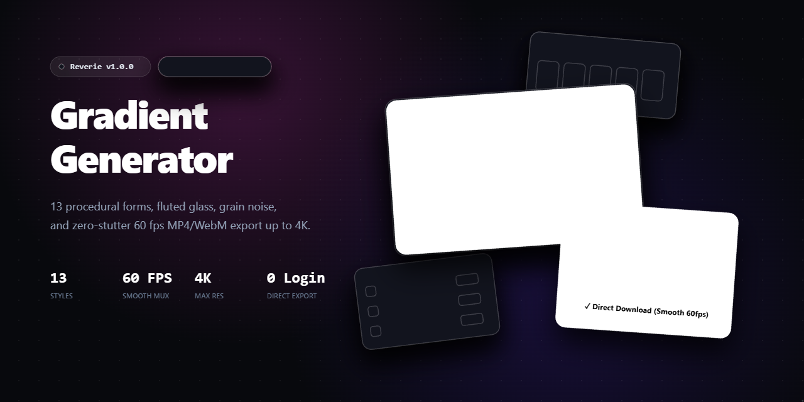

# Reverie — Next-Gen Procedural Gradient Generator & 60 FPS Exporter



**Reverie** is a high-performance procedural gradient generator and precision creative engine. It brings 13 mathematically crafted procedural gradient models, fluted glass optical refraction, cryptographic grain synthesis, photo overlay blending, and interactive typography into the browser — featuring **direct free exports** and a **zero-stutter, frame-paced 60 FPS video export engine**.

---

## 🚀 Key Improvements Over Original

### 1. Fixed Laggy 60 FPS Video Export
* **Root Cause in Original Site**:
  1. **Dual Render Loops Choking Main Thread**: While exporting, the original site ran both its background preview `requestAnimationFrame` loop and its export recording loop simultaneously on the single JavaScript UI thread. At 1080p and 4K, procedural pixel shaders and noise passes require 20–50ms+ per frame, cutting overall framerate down to ~15–25 FPS.
  2. **Real-Time Stream Capture Jitter**: The original code recorded real-time canvas frames via `canvas.captureStream(60)` inside `requestAnimationFrame`. Whenever a frame took longer than 16.6ms, the timing check skipped frames, causing MediaRecorder to record duplicate or dropped frames.
  3. **Wall-Clock Time Skips**: The animation clock advanced by wall-clock elapsed time rather than fixed animation delta, creating jarring visual skips between frames.
* **The Reverie Solution**:
  * **Deterministic Offline Frame Stepping**: Each frame $i$ is rendered at exact mathematical time increments:
    $$\Delta t = \frac{1}{\text{fps}},\quad \text{clock}_i = \text{startClock} + \frac{i}{\text{fps}} \times \frac{\text{speed}}{100}$$
  * **Hardware-Accelerated WebCodecs**: Directly encodes frames via `VideoEncoder` (`avc1.64002a` / High Profile H.264 for MP4, `vp09` for WebM) paired with [`mp4-muxer`](https://github.com/Vanilagy/mp4-muxer) and [`webm-muxer`](https://github.com/Vanilagy/webm-muxer), generating standard, buttery-smooth 60.000 FPS video containers with zero dropped frames.
  * **Dedicated Processing Priority**: Pauses background preview loops during export to dedicate 100% of GPU/CPU resources to video rendering.
  * **Controlled Stream Step Fallback**: For browsers without WebCodecs, implements `canvas.captureStream(0)` with manual `track.requestFrame()` on discrete ticks.

### 2. Zero-Friction Direct Downloads
* Traditional gradient tools often enforce authentication gates before allowing image and video exports.
* **Reverie eliminates the sign-in barrier completely**: PNG, JPG, WebP, SVG, and high-bitrate 60 FPS MP4/WebM exports download immediately with a single click.

---

## 🎨 Features & Capabilities

### 13 Procedural Gradient Engines
| Style | Mathematics & Visual Dynamics |
| :--- | :--- |
| **Melt** | Multi-frequency sinusoidal displacement field with variable peaks, directional melt drift, tilt, and luminance bloom lift. |
| **Mesh** | Procedural radial control point clusters smoothly orbiting around seeded trajectories. |
| **Silk** | Anisotropic wave folding with multi-stage harmonic warp and angular tension. |
| **Beams** | High-intensity angular ray scattering with exponential decay and adjustable focal origin. |
| **Glow** | Multi-blob thermal distortion and warp fields simulating incandescent volumetric illumination. |
| **Ripple** | Concentric wave propagation with polar coordinate distortion and swell dynamics. |
| **Ribbons** | Stratified sine wave ribbons with variable thickness, specular sheen, and stratified depth sorting. |
| **Tide** | Layered wave contours with multi-frequency modulation and gradient fills. |
| **Halo** | Concentric elliptical blooms with customizable squashing and blur dissipation. |
| **Horizon** | Anamorphic radial sun burst with ground plane perspective attenuation. |
| **Linear** | Multi-stop angular linear gradient with continuous rotational drift. |
| **Radial** | Center-drifting multi-stop radial gradient with geometric boundary fitting. |
| **Conic** | Smooth 360-degree rotational sweep gradient with seamless cyclic wrap. |

### Visual Post-Processing Passes
* **Fluted Glass Optics**: Simulates cylindrical ribbed glass bars by sub-slicing the scene into variable optical strips with rounded specular highlights, dark troughs, and refractive edge sheen.
* **Cryptographic Grain Noise**: Precomputed noise tile seeded with `crypto.getRandomValues()`, composited in `overlay` mode with sub-pixel jitter during animation.
* **Photo Underlay & Blend Modes**: Drag and drop any image onto the canvas; adjust zoom, pan, blur, brightness, contrast, and saturation; blend with the gradient using 9 blend modes (`overlay`, `soft-light`, `multiply`, `screen`, `color`, `difference`, etc.) and edge fade gradients.
* **Typography Overlay**: Integrated type layout engine featuring **Geist Variable**, **Geist Mono**, and **Instrument Serif** with dynamic word wrapping, letter tracking, and real-time **WCAG AAA/AA contrast scoring**.

---

## 📂 Project Architecture

```
reverie/
├── assets/
│   ├── social_preview.png         # Primary 1280x640 Open Graph banner
│   ├── social_preview_dark.png    # Obsidian dark variant
│   └── social_preview_light.png   # Studio light variant
├── .github/
│   └── social_preview.png         # GitHub repository preview card
├── banner/
│   ├── index.html                 # Source banner composition
│   ├── dark.html                  # Dark banner composition
│   └── hyperframes.json           # HyperFrames manifest (1280x640 @ 60fps)
├── fonts/
│   ├── Geist-Variable.woff2       # Primary sans-serif
│   ├── GeistMono-Variable.woff2   # Monospace badge & metric font
│   └── instrument-serif-italic-latin.woff2 # Editorial serif font
├── js/
│   ├── account.js                 # Session manager (unlocked tier)
│   ├── colour.js                  # HSL/RGB math & Gaussian stack mixing
│   ├── controls.js                # Sliders, palette presets & stop editor
│   ├── dom.js                     # Safe DOM utility functions
│   ├── exporter.js                # Enhanced 60fps WebCodecs & Muxer engine
│   ├── main.js                    # Orchestration, preview loop & canvas sizing
│   ├── persist.js                 # Safe session state persistence
│   ├── render.js                  # 13 gradient shaders & post-passes
│   ├── signin.js                  # Bypassed direct download provider
│   ├── state.js                   # Reactive state store
│   └── vendor/
│       ├── mp4-muxer.js           # Pure ESM MP4 container muxer
│       └── webm-muxer.js          # Pure ESM WebM container muxer
├── index.html                     # Main application entry
├── gradients.css                  # Production stylesheet
└── package.json                   # Dependencies (Vite, mp4-muxer, webm-muxer)
```

---

## 🛠️ Getting Started

### Local Development
```bash
# 1. Clone repository and install dependencies
git clone https://github.com/your-username/reverie.git
cd reverie
npm install

# 2. Start Vite development server
npm run dev

# 3. Open in browser
# Navigate to http://localhost:5173
```

### Static Hosting
Reverie is authored as standalone native ES modules. You can deploy it directly to GitHub Pages, Netlify, Vercel, or any static file server without a build step:
```bash
npx serve .
```

---

## 🤖 Using as an AI Agent Skill

This repository is pre-configured with `SKILL.md` and `AGENTS.md` for AI coding agents (**Antigravity**, **Claude Code**, **Cursor**, **Windsurf**, **Codex**).

### Install into Your Agent Workspace
```bash
# Antigravity / Gemini CLI (Global)
git clone https://github.com/Fazzbro/saas-procedural-gradients.git ~/.gemini/config/skills/saas-procedural-gradients

# Standalone Agent Skill Repository
# https://github.com/Fazzbro/saas-procedural-gradients
```

When activated, agents automatically discover:
1. All 13 procedural gradient field mathematical algorithms.
2. Fluted glass refraction passes (`glassPass`) and film grain noise (`grainPass`).
3. Deterministic Remotion React components and HyperFrames continuous canvas scripts.

---

## 📄 License
MIT License © 2026 Reverie.
